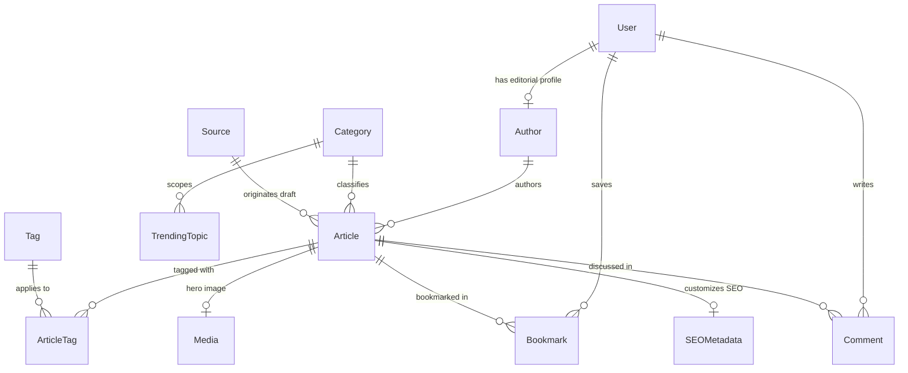
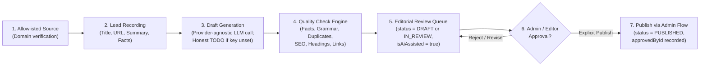

# Architecture Plan — VYBE Media Platform

> **Brand Configuration Note:** The platform display name is **VYBE**, controlled globally via the `NEXT_PUBLIC_SITE_NAME` environment variable (defaulting to `"VYBE"` in `lib/config.ts`). All UI surfaces, SEO metadata templates, and structured data definitions reference this single source of truth. Official tagline, logo, and production domain are not yet decided and use neutral `TODO` placeholders in Phase 1.

---

## 1. Executive Summary & Architectural Goals

The **VYBE** platform is an international English-language music, artist, and pop-culture journalism website built for:
1. **Editorial Authority & Compliance:** Zero fabricated quotes, zero scraped/copied third-party articles, and a strictly human-gated AI drafting pipeline (**Draft → Admin Approval → Publish**, with auto-publishing disabled by default).
2. **Search Engine & Reader Performance:** Server-first rendering via Next.js App Router, semantic HTML5 document structure, rich Schema.org (`NewsArticle`, `BreadcrumbList`, `WebSite`) metadata, and a minimal client-side JavaScript footprint.
3. **Low-Overhead Portability:** Runs locally on constrained developer VMs using SQLite (`file:./dev.db`) and scales in production on Vercel + managed PostgreSQL without code changes to domain logic.

---

## 2. Technology Stack & Rationale

| Layer | Technology | Rationale |
| :--- | :--- | :--- |
| **Framework** | **Next.js 14 (App Router) + React 18** | First-class Server Components (RSC), streaming SSR, Incremental Static Regeneration (ISR) for high-traffic article pages, built-in `Metadata` API for SEO, and co-located Route Handlers for backend endpoints. Keeps build and runtime memory lower on constrained VMs compared to heavier bundler stacks. |
| **Language** | **TypeScript 5 (`strict: true`)** | End-to-end compile-time type safety across database models, API payloads, server components, and editorial state machines. |
| **Styling** | **Tailwind CSS 3 + PostCSS** | Zero runtime CSS-in-JS overhead, deterministic small CSS bundle, class-based dark/light mode (`darkMode: "class"`), and clean responsive utilities for multi-column editorial layouts. |
| **Database & ORM** | **Prisma ORM (SQLite in Dev, PostgreSQL in Prod)** | Single declarative schema definition (`prisma/schema.prisma`) with type-safe queries. SQLite requires zero background daemon RAM during local development; PostgreSQL provides concurrent writes, JSONB indexing, and Full-Text Search (`tsvector`) in production. |
| **Authentication** | **Auth.js (NextAuth) + Argon2id / Web Crypto** | Stateless encrypted HTTP-only session cookies with database user lookup for editorial actions. Supports Role-Based Access Control (`READER`, `AUTHOR`, `EDITOR`, `ADMIN`) without external SaaS auth lock-in. |
| **Validation** | **Zod** (Phase 2+) | Runtime schema validation for API inputs, environment variables, and structured AI draft outputs. |
| **Media Delivery** | **`next/image` + S3-Compatible Storage (R2 / S3)** | Phase 1 uses pure CSS gradient art placeholders to avoid hotlinked or copyrighted imagery. Phase 2+ stores licensed/original media in Cloudflare R2 or AWS S3 with `next/image` WebP/AVIF resizing. |

---

## 3. Repository & Folder Structure

```text
kangen/
├── app/                              # Next.js App Router routes
│   ├── layout.tsx                    # Root HTML shell, global metadata, Header & Footer
│   ├── page.tsx                      # Homepage: Hero, Trending, Latest News, Newsletter
│   ├── globals.css                   # Tailwind directives & editorial typography defaults
│   ├── not-found.tsx                 # Custom 404 page for unknown categories/articles
│   ├── search/
│   │   └── page.tsx                  # Search page (/search?q=...)
│   ├── category/
│   │   └── [slug]/
│   │       └── page.tsx              # Alias category route (/category/[slug])
│   ├── [category]/
│   │   ├── page.tsx                  # Category landing page (/[category])
│   │   └── [slug]/
│   │       └── page.tsx              # Article detail page (/[category]/[slug])
│   ├── admin/                        # [Phase 3 TODO] Protected editorial & admin dashboard
│   └── api/                          # [Phase 2+ TODO] REST Route Handlers (/api/v1/...)
├── components/                       # Reusable UI & editorial components
│   ├── Header.tsx                    # Top masthead, category nav, mobile menu, search & theme toggle
│   ├── Footer.tsx                    # Site links, category directory, editorial standards notice
│   ├── ArticleCard.tsx               # Polymorphic card (hero, standard, compact, horizontal)
│   ├── Newsletter.tsx                # Newsletter signup section (Phase 1 UI skeleton)
│   ├── SearchBar.tsx                 # Accessible GET search form targeting /search
│   └── ThemeToggle.tsx               # Client-side dark/light theme switcher
├── lib/                              # Shared domain logic, configuration, and data access
│   ├── config.ts                     # Single source of truth for NEXT_PUBLIC_SITE_NAME & categories
│   ├── types.ts                      # Core TypeScript interfaces mirroring the domain data model
│   ├── db.ts                         # PrismaClient singleton (global hot-reload safe)
│   ├── articles.ts                   # Prisma read repository for public pages (with build fallback)
│   ├── sample-articles.ts            # Build-time fallback sample/placeholder fixtures
│   ├── auth/                         # [Phase 3/4 TODO] Session utilities & RBAC guards
│   ├── seo/                          # [Phase 3 TODO] JSON-LD builders & sitemap helpers
│   └── ai/                           # [Phase 4 TODO] Source ingestion & human-gated draft pipeline
├── prisma/                           # Prisma ORM schema, migrations, and idempotent seed
│   ├── schema.prisma                 # 13 core entities + 7 enums (SQLite dev / PostgreSQL prod)
│   ├── seed.ts                       # Idempotent seed script (9 categories, 3 authors, 9 sample articles)
│   └── migrations/                   # SQL migration history (20261101090938_phase2_init)
├── docs/                             # Project documentation & phase specifications
│   ├── PHASE1_PROMPT.md              # Phase 1 prompt specification (preserved)
│   └── ARCHITECTURE.md               # This architecture specification
├── public/                           # Static assets (robots.txt, favicon)
├── .env.example                      # Safe placeholder environment variables
├── next.config.mjs                   # Next.js configuration (memory-optimized)
├── tailwind.config.ts                # Tailwind theme & dark mode configuration
├── postcss.config.mjs                # PostCSS configuration
├── tsconfig.json                     # Strict TypeScript configuration
└── package.json                      # Minimal dependencies and scripts
```

---

## 4. Data Model Outline (13 Core Entities)

The relational schema is designed for both SQLite (local development) and PostgreSQL (production). All primary keys use UUIDv4/CUID strings (`id`), and timestamps use UTC ISO-8601 (`DateTime`).



### 4.1 `User`
Represents any registered account (readers, writers, editors, administrators).
- `id`: `String` (PK, UUID)
- `email`: `String` (Unique, indexed, lowercase)
- `passwordHash`: `String?` (Argon2id/bcrypt hash; nullable for OAuth-only users)
- `displayName`: `String`
- `avatarUrl`: `String?`
- `role`: `Enum('READER', 'AUTHOR', 'EDITOR', 'ADMIN')` (default `'READER'`)
- `isActive`: `Boolean` (default `true`)
- `emailVerifiedAt`: `DateTime?`
- `createdAt`: `DateTime`
- `updatedAt`: `DateTime`

### 4.2 `Author`
Public editorial profile linked to staff writers or guest contributors.
- `id`: `String` (PK, UUID)
- `userId`: `String?` (FK → `User.id`, Unique, nullable for external/syndicated contributors)
- `slug`: `String` (Unique, indexed, e.g. `editorial-desk`)
- `penName`: `String`
- `roleTitle`: `String` (e.g. `"Senior Music Features Editor"`)
- `bio`: `String`
- `avatarUrl`: `String?`
- `socialLinksJson`: `String?` (JSON string of verified links)
- `isStaff`: `Boolean` (default `true`)
- `createdAt`: `DateTime`
- `updatedAt`: `DateTime`

### 4.3 `Article`
Core content entity governed by an explicit editorial workflow state machine.
- `id`: `String` (PK, UUID)
- `slug`: `String` (Unique, indexed)
- `title`: `String`
- `subtitle`: `String?`
- `excerpt`: `String`
- `bodyMarkdown`: `String`
- `bodyHtml`: `String?` (Sanitized pre-rendered HTML cache)
- `status`: `ArticleStatus` (`'DRAFT' | 'IN_REVIEW' | 'APPROVED' | 'PUBLISHED' | 'ARCHIVED'`, default `'DRAFT'`, indexed)
- `isFeatured`: `Boolean` (default `false`, indexed)
- `isTrending`: `Boolean` (default `false`, indexed)
- `trendingRank`: `Int?` (Optional rank ordering for trending stories)
- `isAiAssisted`: `Boolean` (default `false`)
- `isSampleContent`: `Boolean` (default `false`; set to `true` for seeded Phase 1/2 sample fixtures)
- `editorialNote`: `String?` (Internal/disclosure note, e.g., marking seeded `SAMPLE / PLACEHOLDER CONTENT`)
- `coverGradient`: `String?` (Tailwind CSS gradient class when no `heroMedia` image is attached)
- `coverLabel`: `String?` (Placeholder artwork label for sample/gradient cards)
- `publishedDisplay`: `String?` (Formatted display label or sample fixture notice)
- `readingTimeMinutes`: `Int` (default `3`)
- `viewCount`: `Int` (default `0`)
- `authorId`: `String` (FK → `Author.id`, indexed)
- `categoryId`: `String` (FK → `Category.id`, indexed)
- `heroMediaId`: `String?` (FK → `Media.id`)
- `seoMetadataId`: `String?` (FK → `SEOMetadata.id`, Unique)
- `sourceId`: `String?` (FK → `Source.id`, nullable for wholly original reporting)
- `approvedById`: `String?` (FK → `User.id`; required before `status` can become `'PUBLISHED'`)
- `approvedAt`: `DateTime?`
- `publishedAt`: `DateTime?` (Indexed for chronological feeds)
- `createdAt`: `DateTime`
- `updatedAt`: `DateTime`
- **Indexes:** `(slug)`, `(categoryId)`, `(authorId)`, `(status)`, `(publishedAt)`, `(isFeatured)`, `(isTrending)`, `(categoryId, status, publishedAt DESC)`, `(status, isFeatured, publishedAt DESC)`

### 4.4 `Category`
Top-level navigation and taxonomy buckets (`music`, `celebrity`, `artists`, `albums`, `singles`, `pop-culture`, `trending`, `interviews`, `reviews`).
- `id`: `String` (PK, UUID)
- `slug`: `String` (Unique, indexed)
- `name`: `String`
- `description`: `String`
- `accentColor`: `String` (Tailwind gradient string for section hero headers)
- `parentId`: `String?` (FK → `Category.id` for sub-categories)
- `sortOrder`: `Int` (default `0`, indexed)
- `isActive`: `Boolean` (default `true`)
- `createdAt`: `DateTime`
- `updatedAt`: `DateTime`

### 4.5 `Tag`
Fine-grained topic descriptors (`vinyl-production`, `touring-logistics`, `sound-engineering`, etc.).
- `id`: `String` (PK, UUID)
- `slug`: `String` (Unique, indexed)
- `name`: `String`
- `description`: `String?`
- `createdAt`: `DateTime`

### 4.6 `ArticleTag`
Many-to-many join entity associating `Article` and `Tag`.
- `articleId`: `String` (FK → `Article.id`, onDelete: Cascade)
- `tagId`: `String` (FK → `Tag.id`, onDelete: Cascade)
- `assignedAt`: `DateTime` (default `now()`)
- **Primary Key:** Composite `(articleId, tagId)`
- **Indexes:** `(tagId, articleId)`

### 4.7 `Bookmark`
Reader-saved articles for later reading.
- `id`: `String` (PK, UUID)
- `userId`: `String` (FK → `User.id`, onDelete: Cascade)
- `articleId`: `String` (FK → `Article.id`, onDelete: Cascade)
- `createdAt`: `DateTime`
- **Unique Constraint:** `(userId, articleId)`

### 4.8 `Comment`
Moderated reader discussions on published articles.
- `id`: `String` (PK, UUID)
- `articleId`: `String` (FK → `Article.id`, indexed, onDelete: Cascade)
- `userId`: `String` (FK → `User.id`, onDelete: Cascade)
- `parentId`: `String?` (FK → `Comment.id` for single-level replies)
- `body`: `String` (Max 2,000 characters, stripped of HTML)
- `status`: `Enum('PENDING', 'APPROVED', 'REJECTED', 'FLAGGED')` (default `'PENDING'`, indexed)
- `moderatedById`: `String?` (FK → `User.id`)
- `createdAt`: `DateTime`
- `updatedAt`: `DateTime`

### 4.9 `Media`
Managed image/audio/video assets with mandatory attribution and accessibility metadata.
- `id`: `String` (PK, UUID)
- `url`: `String`
- `storageKey`: `String` (Unique S3/R2 object key)
- `altText`: `String` (Required for accessibility & image SEO)
- `caption`: `String?`
- `credit`: `String` (Mandatory licensing/photographer attribution)
- `mimeType`: `String`
- `width`: `Int?`
- `height`: `Int?`
- `sizeBytes`: `Int`
- `uploadedById`: `String` (FK → `User.id`)
- `createdAt`: `DateTime`

### 4.10 `SEOMetadata`
Per-article search & social sharing overrides.
- `id`: `String` (PK, UUID)
- `metaTitle`: `String?` (Overrides `Article.title` when present; max 65 chars recommended)
- `metaDescription`: `String?` (Overrides `Article.excerpt`; max 160 chars recommended)
- `canonicalUrl`: `String?`
- `ogTitle`: `String?`
- `ogDescription`: `String?`
- `ogImageUrl`: `String?`
- `twitterCardType`: `Enum('summary', 'summary_large_image')` (default `'summary_large_image'`)
- `noIndex`: `Boolean` (default `false`; automatically forced `true` on unpublished or sample content in prod)
- `noFollow`: `Boolean` (default `false`)
- `structuredDataJson`: `String?` (Custom JSON-LD override)
- `updatedAt`: `DateTime`

### 4.11 `TrendingTopic`
Curated or algorithmically scored topics displayed in the site-wide trending bar and homepage module.
- `id`: `String` (PK, UUID)
- `slug`: `String` (Unique, indexed)
- `label`: `String`
- `categoryId`: `String?` (FK → `Category.id`)
- `score`: `Float` (default `0.0`, indexed descending)
- `velocity`: `Float` (default `0.0`)
- `isPinned`: `Boolean` (default `false`)
- `expiresAt`: `DateTime?`
- `updatedAt`: `DateTime`

### 4.12 `Source`
Allowlisted external press feeds, official artist channels, or wire services monitored for story leads.
- `id`: `String` (PK, UUID)
- `name`: `String`
- `domain`: `String`
- `feedUrl`: `String?` (Unique)
- `sourceType`: `Enum('RSS', 'PRESS_RELEASE', 'OFFICIAL_STATEMENT', 'MANUAL')`
- `trustTier`: `Int` (1 = primary official source, 2 = verified trade agency, 3 = secondary lead)
- `isEnabled`: `Boolean` (default `true`)
- `lastFetchedAt`: `DateTime?`
- `createdAt`: `DateTime`

### 4.13 `NewsletterSubscriber`
Double opt-in email newsletter subscribers.
- `id`: `String` (PK, UUID)
- `email`: `String` (Unique, indexed, lowercase)
- `status`: `Enum('PENDING_CONFIRMATION', 'SUBSCRIBED', 'UNSUBSCRIBED', 'BOUNCED')` (default `'PENDING_CONFIRMATION'`)
- `frequencyPreference`: `Enum('DAILY', 'WEEKLY', 'BREAKING_ONLY')` (default `'WEEKLY'`)
- `confirmTokenHash`: `String?` (SHA-256 hash of single-use confirmation token)
- `confirmedAt`: `DateTime?`
- `unsubscribedAt`: `DateTime?`
- `createdAt`: `DateTime`

### 4.14 Phase 2 Database Operations & SQLite → PostgreSQL Provider Switch

#### Local Development (SQLite)
1. Ensure `.env` exists with `DATABASE_URL="file:./dev.db"` (`cp .env.example .env`).
2. Generate Prisma Client and apply migrations:
   ```bash
   NODE_OPTIONS="--max-old-space-size=1024" npx prisma generate
   NODE_OPTIONS="--max-old-space-size=1024" npx prisma migrate dev --name phase2_init
   ```
3. Run the idempotent seed script (populates 9 categories, 3 sample authors, 9 original sample articles with `isSampleContent = true`, 28 tags, 36 article-tag links, and 6 trending topics; creates 0 user accounts):
   ```bash
   NODE_OPTIONS="--max-old-space-size=1024" npm run db:seed
   ```

#### Production Switch (SQLite → PostgreSQL)
`prisma/schema.prisma` is written using 100% portable Prisma scalar types (`String`, `Int`, `Float`, `Boolean`, `DateTime`) and native Prisma `enum` definitions (`Role`, `ArticleStatus`, `CommentStatus`, `TwitterCardType`, `SourceType`, `SubscriberStatus`, `NewsletterFrequency`) supported by both SQLite (Prisma 6.x) and PostgreSQL:
1. In `prisma/schema.prisma`, change the `datasource db` block from:
   ```prisma
   datasource db {
     provider = "sqlite"
     url      = env("DATABASE_URL")
   }
   ```
   to:
   ```prisma
   datasource db {
     provider  = "postgresql"
     url       = env("DATABASE_URL")
     directUrl = env("DIRECT_DATABASE_URL")
   }
   ```
2. Set `DATABASE_URL="postgresql://..."` (pooled connection string) and `DIRECT_DATABASE_URL="postgresql://..."` (direct connection string for migrations) in the production environment.
3. **Model Field Changes Required:** **None.** Zero model fields require modification when switching from SQLite to PostgreSQL because JSON payloads (`Author.socialLinksJson`, `SEOMetadata.structuredDataJson`) are stored as portable `String?` fields and all 7 enums are native Prisma enums. (Optional optimization in PostgreSQL: `String` columns such as `Article.bodyMarkdown` map to PostgreSQL `TEXT` automatically in Prisma without `@db.Text` annotations.)

---

## 5. API Outline (Phase 2+ Route Handlers)

All endpoints return a consistent JSON envelope:
- Success: `{ "data": <T>, "meta"?: { "page": number, "pageSize": number, "total": number } }`
- Error: `{ "error": { "code": string, "message": string, "details"?: unknown } }`

### 5.1 Public Content APIs
- `GET /api/v1/articles` — Paginated list of `PUBLISHED` articles (`?category=music&tag=vinyl&page=1&limit=12`).
- `GET /api/v1/articles/[slug]` — Single published article with author, category, tags, media, and SEO metadata.
- `GET /api/v1/categories` — Active categories ordered by `sortOrder`.
- `GET /api/v1/trending` — Top active `TrendingTopic` records and trending articles.
- `GET /api/v1/search?q=<query>&category=<slug>` — Full-text search across published articles.
- `POST /api/v1/newsletter/subscribe` — Rate-limited double-opt-in subscription initiation.
- `GET /api/v1/newsletter/confirm?token=<token>` — Confirms subscriber status.

### 5.2 Authenticated Reader APIs
- `GET /api/v1/bookmarks` — List current user's bookmarked articles.
- `POST /api/v1/bookmarks` — Toggle/create bookmark (`{ articleId }`).
- `DELETE /api/v1/bookmarks/[articleId]` — Remove bookmark.
- `GET /api/v1/articles/[slug]/comments` — List `APPROVED` comments for an article.
- `POST /api/v1/articles/[slug]/comments` — Submit a comment (created with `status = 'PENDING'` for moderation).

### 5.3 Editorial & Admin APIs (Protected by RBAC)
- `GET /api/v1/admin/articles` — Filter articles by status (`DRAFT`, `IN_REVIEW`, `APPROVED`, `PUBLISHED`, `ARCHIVED`), source, or author.
- `POST /api/v1/admin/articles` — Create manual draft (`AUTHOR`, `EDITOR`, `ADMIN`).
- `PATCH /api/v1/admin/articles/[id]` — Update draft content, tags, media, or SEO metadata.
- `POST /api/v1/admin/articles/[id]/submit-review` — Transition `DRAFT → IN_REVIEW`.
- `POST /api/v1/admin/articles/[id]/approve` — Transition `IN_REVIEW → APPROVED` (`EDITOR`, `ADMIN` only; records `approvedById` and `approvedAt`).
- `POST /api/v1/admin/articles/[id]/publish` — Transition `APPROVED → PUBLISHED` (`EDITOR`, `ADMIN` only; verifies `approvedById` is non-null, sets `publishedAt`, triggers `revalidatePath`).
- `POST /api/v1/admin/ai/drafts` — Trigger AI-assisted draft generation from an allowlisted `Source` lead (creates `DRAFT` only).
- `PATCH /api/v1/admin/comments/[id]` — Approve, reject, or flag reader comments.
- `POST /api/v1/admin/media/presign` — Generate signed S3/R2 upload URL.

---

## 6. Authentication & Authorization Outline

1. **Session Architecture:**
   - HTTP-only, `SameSite=Lax`, `Secure` (in production) session cookies signed with `AUTH_SECRET`.
   - Passwords hashed exclusively with **Argon2id** (or `bcrypt` cost factor ≥ 12) before database storage; plaintext passwords are never logged or persisted.
2. **Role-Based Access Control (RBAC):**
   - `READER`: Can bookmark articles and submit comments (held in `PENDING` moderation queue).
   - `AUTHOR`: Can create/edit own `DRAFT` articles, run AI draft assistance, and submit drafts for review (`IN_REVIEW`). Cannot approve or publish.
   - `EDITOR`: Can edit any article, moderate comments, manage `TrendingTopic` items, approve drafts (`APPROVED`), and publish (`PUBLISHED`).
   - `ADMIN`: Full platform control including user role management, `Source` allowlist configuration, and system settings.
3. **Route Protection:**
   - Next.js Middleware (`middleware.ts` in Phase 2/3) inspects session tokens on `/admin/:path*` and `/api/v1/admin/:path*`, returning `401 Unauthorized` or `403 Forbidden` before handler execution.

---

## 7. SEO, Syndication & Editorial Standards Architecture (Phase 8)

1. **Metadata & Canonical URLs:**
   - Every public route implements Next.js `Metadata` / `generateMetadata`.
   - Title template: `%s | ${SITE_NAME}` (dynamically using `NEXT_PUBLIC_SITE_NAME`).
   - Explicit canonical URLs (`alternates.canonical`) prevent duplicate indexing across query parameters or category/author alias paths.
   - Per-article SEO overrides: articles load custom `SEOMetadata` configured in Phase 6 (meta title, meta description, canonical URL, OG tags, Twitter card type, and `noIndex`/`noFollow` robots directives), with robust fallbacks to core article title/excerpt.
   - Category pages (`/[category]` and `/category/[slug]`) and author pages (`/author/[slug]` and `/authors/[slug]`) emit canonical URLs, Open Graph `website`/`profile`, and Twitter cards.

2. **Semantic HTML & Heading Hierarchy:**
   - Strict single `<h1>` per page (site masthead on `/`, category name on `/[category]`, article title on `/[category]/[slug]`, author penName on `/author/[slug]`).
   - Logical `<h2>` and `<h3>` section landmarks inside `<main>`, `<article>`, `<section>`, `<nav>`, `<aside>`, and `<footer>`.
   - Internal linking: article pages link to related articles, category pages, and author profile pages (`/author/${author.slug}`).

3. **Structured Data (Schema.org JSON-LD):**
   - **Homepage (`/`):** Server-renders both `WebSite` (with `SearchAction`) and `Organization` JSON-LD schemas.
   - **Category Pages (`/[category]`):** Server-renders `BreadcrumbList` (Home → Category Name).
   - **Article Pages (`/[category]/[slug]`):** Server-renders `NewsArticle` (with headline, datePublished, dateModified, articleSection, keywords, author Person, publisher Organization), `BreadcrumbList` (Home → Category → Article), author card `Person` schema, and optional custom `structuredDataJson` from `SEOMetadata`.
   - **Author Pages (`/author/[slug]`):** Server-renders `Person` (penName, roleTitle, bio, url) and `BreadcrumbList`.
   - **Data Integrity:** Real server-rendered database values only. Zero fabricated ratings, review counts, view counts, or false dates.

4. **Dynamic Sitemap (`/sitemap.xml` via `app/sitemap.ts`):**
   - Queries Prisma for active categories, published articles (via `publicArticleWhere()`), and authors with published articles.
   - `lastModified` timestamps derived directly from database `updatedAt` / `publishedAt`.
   - Strictly excludes drafts, in-review, scheduled future articles, archived articles, and private routes (`/admin`, `/api`, `/profile`, auth pages).
   - Core static pages (`/`, `/search`) included with prioritized weights (1.0 for home, 0.8 for categories, 0.7-0.9 for articles, 0.6 for authors).

5. **Crawl Directives (`/robots.txt` via `app/robots.ts`):**
   - Allows public indexation (`Allow: /`).
   - Disallows private, administrative, and user session routes (`/admin`, `/api`, `/login`, `/register`, `/profile`, `/reset-password`, `/forgot-password`).
   - Dynamically advertises the sitemap URL based on resolved base URL (`${baseUrl}/sitemap.xml`).

6. **RSS & Syndication (`/feed.xml` and `/rss.xml`):**
   - Native RSS 2.0 feed served at `/feed.xml` with channel metadata (`title`, `link`, `description`, `lastBuildDate`, `atom:link`).
   - Lists published articles exclusively (`publicArticleWhere()`), with title, link, guid, description, pubDate, author, and category tags.
   - `/rss.xml` issues an HTTP 308 permanent redirect to `/feed.xml`.
   - Layout head advertises RSS feed auto-discovery via `<link rel="alternate" type="application/rss+xml" href="/feed.xml" />`.

7. **Base URL Resolution & Honest Production Requirements:**
   - Base URL resolution order: `NEXT_PUBLIC_SITE_URL` → `NEXTAUTH_URL` → `AUTH_URL` → `"http://localhost:3000"`.
   - **TODO (Production Domain Decision):** Official production domain is not yet decided. Before production launch and search engine submission, `NEXT_PUBLIC_SITE_URL` MUST be configured to the decided domain (e.g., `https://vybe.example.com`).
   - **TODO (Google Search Console & Bing Webmaster Verification):** Verification tokens (HTML meta tag or DNS TXT record) require the final domain and Search Console property setup. No fake verification tokens or placeholder domain claims are permitted.

---

## 8. AI Content Pipeline Outline (Strict Human-in-the-Loop)

> [!IMPORTANT]
> **Hard Policy — Double-Gated Auto-Publish Prohibition:**
> AI-generated or AI-assisted content can **never** bypass human editorial approval.
> 1. `AI_AUTO_PUBLISH` is shipped as `"false"`.
> 2. Even if `AI_AUTO_PUBLISH` is set to `"true"`, publication remains blocked in code unless a secondary flag `AI_AUTO_PUBLISH_ENABLED_BY_ADMIN="true"` is also explicitly configured.
> 3. Created articles are always assigned `status = 'DRAFT'` (or `'IN_REVIEW'`) with `publishedAt = null` upon generation.
> 4. Publication requires an authenticated `EDITOR` or `ADMIN` explicitly approving and publishing via `publishArticle`.



### Pipeline Stages & Modules

1. **Source Allowlist Service (`lib/ai/source-service.ts`):**
   - Stores verified news sources (`Source` model: Billboard, Variety, Pitchfork, AP, Reuters, official artist sites, record labels).
   - Enforces domain allowlist: leads with URLs from unauthorized domains are rejected.
   - **Zero Scraping Policy:** Full-text scraping of copyrighted or paywalled articles is prohibited. The pipeline ingests only lead metadata, source URLs, and short summaries.

2. **Lead Ingestion Service (`lib/ai/lead-service.ts`):**
   - Ingests candidates into the `Lead` model (`NEW` status).
   - Captures headline, canonical source URL, system/editor summary (max 1500 chars), verified facts checklist, and confidence score.
   - Editors can review, approve, reject, or convert leads into drafts.

3. **Provider-Agnostic LLM Generator (`lib/ai/provider.ts`):**
   - Server-side module supporting Gemini and OpenAI-compatible endpoints via native `fetch` (no heavy third-party SDKs, zero `agy` CLI dependency).
   - **Honest Configuration Guard:** If `AI_PROVIDER_API_KEY` is not set or retains placeholder values, draft generation fails immediately with a descriptive error (`AiConfigurationError`):
     `"TODO: AI provider API key is not configured. Set AI_PROVIDER_API_KEY in environment variables to enable draft generation."`
     No mock articles or fake drafts are fabricated.
   - Prompts enforce original journalistic prose, neutral tone, citation of verified facts, flagging of unverified claims, heading structure (`## ` and `### `), suggested tags, SEO metadata, and art direction image prompts.

4. **Editorial Quality Check Engine (`lib/ai/quality-check.ts`):**
   Runs a 6-dimension pre-review audit:
   - **Factual Accuracy:** verifies external source citations, calculates confidence level, flags unverified claims.
   - **Grammar & Spelling Heuristics:** detects duplicate adjacent words ("the the"), excessive punctuation ("!!!"), unmatched quotes/parentheses, and run-on sentences.
   - **Duplicate / Plagiarism Risk:** compares title & excerpt against all existing articles in the Prisma database (token Jaccard similarity & Levenshtein). Flags similarity >= 35%, rejects exact duplicates.
   - **SEO Metadata Completeness:** validates title length (30-70c), description length (80-200c), and OpenGraph tags.
   - **Heading Hierarchy:** enforces H2 (`## `) section headings, ensures H3 follows H2, prohibits H1 in markdown body.
   - **Internal Link Recommendations:** queries published articles in the DB matching tags/category.
   - **Low-Confidence Routing:** drafts scoring < 75 or containing unverified claims automatically enter status `IN_REVIEW` (never `PUBLISHED`).

5. **Human-Gated Admin Workflow (`lib/admin/service.ts` & `app/admin/`):**
   - Admin UI tabs: `/admin/leads` and `/admin/sources`.
   - In the article editor (`/admin/articles/[id]`), an AI-assisted banner highlights mandatory review.
   - The editor includes an interactive Quality Checks panel showing scores, checklists, and a "Run Quality Check" button to re-evaluate modified text in real time.
   - Drafts can transition to `PUBLISHED` only through `publishArticle` by a human `EDITOR` or `ADMIN`.

6. **Manual Trigger & Scheduled Scanning (`lib/ai/scanner.ts`):**
   - Manual trigger endpoint: `POST /api/v1/admin/ai/scan` and CLI runner `npm run ai:scan`.
   - **Honest Architectural Notice:** Autonomous background cron jobs that scrape external sites without publisher agreements and API keys are intentionally NOT scheduled. Periodic cron scanning is a documented Phase 8 TODO.

---

## 9. Deployment Outline (SQLite Local Dev → Vercel + PostgreSQL Production)

| Environment | Compute | Database | Media Storage | Caching / Revalidation |
| :--- | :--- | :--- | :--- | :--- |
| **Local Dev** | `npm run dev` (Node 24) | SQLite (`file:./dev.db`) | CSS placeholders / `public/uploads` | On-demand SSR |
| **CI / Preview** | Vercel Preview / Container | Ephemeral SQLite or Neon Branch | R2 Preview Bucket | ISR + `revalidateTag` |
| **Production** | Vercel Serverless / Edge | Managed PostgreSQL (Neon / Supabase) with PgBouncer | Cloudflare R2 / AWS S3 + CDN | ISR (60s fallback) + On-Demand `revalidatePath` on publish |

### Memory-Constrained Build Strategy
On low-memory build machines (such as VMs with <1 GB free RAM):
- Keep `dependencies` minimal (`next`, `react`, `react-dom`).
- Configure `next.config.mjs` with `experimental: { cpus: 1, workerThreads: false, webpackMemoryOptimizations: true }` to prevent multi-worker OOM spikes.
- Run builds with `NODE_OPTIONS="--max-old-space-size=1024"`.

---

## 10. Environment Variables List

All secrets are loaded via environment variables and never committed to git. See `.env.example` for safe local placeholders.

| Variable | Scope | Required | Default / Example | Purpose |
| :--- | :--- | :--- | :--- | :--- |
| `NEXT_PUBLIC_SITE_NAME` | Public (`client` + `server`) | No | `"VYBE"` | Global brand display name used across UI and SEO metadata. |
| `NEXT_PUBLIC_SITE_URL` | Public (`client` + `server`) | No | `"http://localhost:3000"` | Base canonical URL (production domain TBD/TODO). |
| `NEXT_PUBLIC_SITE_DESCRIPTION` | Public (`client` + `server`) | No | `"TODO: Official tagline pending..."` | Default meta description placeholder until official tagline is decided. |
| `DATABASE_URL` | Server-only | Phase 2+ | `"file:./dev.db"` (dev) / `"postgresql://..."` (prod) | Primary Prisma database connection string. |
| `DIRECT_DATABASE_URL` | Server-only | Prod only | `"postgresql://..."` | Direct (non-pooled) PostgreSQL URL for `prisma migrate deploy`. |
| `AUTH_SECRET` | Server-only | Phase 2+ | `""` (32+ byte random base64) | Secret key for signing/encrypting session tokens. |
| `AUTH_URL` | Server-only | Phase 2+ | `"http://localhost:3000"` | Canonical callback URL for Auth.js. |
| `AI_PROVIDER` | Server-only | Phase 7 | `"gemini"` | Provider identifier (`gemini` or `openai`). |
| `AI_PROVIDER_API_KEY` | Server-only | Phase 7 | `""` | API key for server-side LLM draft generation. If unset, fails honestly with TODO error. |
| `AI_MODEL_NAME` | Server-only | Phase 7 | `"gemini-2.5-flash"` | Model identifier used by the AI draft generator. |
| `AI_AUTO_PUBLISH` | Server-only | Phase 7 | `"false"` | **Must remain `"false"`.** Primary auto-publish guardrail. |
| `AI_AUTO_PUBLISH_ENABLED_BY_ADMIN` | Server-only | Phase 7 | `"false"` | Secondary override guardrail. Both must be true for auto-publish. Shipped as false. |
| `STORAGE_ENDPOINT` | Server-only | Phase 3+ | `""` | S3/R2 endpoint for editorial media uploads. |
| `STORAGE_BUCKET_NAME` | Server-only | Phase 3+ | `"vybe-media-assets-placeholder"` | Bucket name for uploaded media. |
| `STORAGE_ACCESS_KEY_ID` | Server-only | Phase 3+ | `""` | S3/R2 access key ID. |
| `STORAGE_SECRET_ACCESS_KEY` | Server-only | Phase 3+ | `""` | S3/R2 secret access key. |
| `NEWSLETTER_API_KEY` | Server-only | Phase 2+ | `""` | Transactional email provider key for double opt-in confirmation emails. |
| `CRON_SECRET` | Server-only | Phase 4+ | `""` | Bearer secret verifying scheduled feed-ingestion triggers. |

---

## 11. Risks, Assumptions & Mitigations

| Category | Risk / Assumption | Mitigation Strategy |
| :--- | :--- | :--- |
| **Editorial & Legal** | AI models may hallucinate artist quotes, release dates, or chart rankings if left unchecked. | Enforce **Draft → Admin Approval → Publish** in code and database schema; run automated quote/number verification against primary source text; prohibit auto-publishing (`AI_AUTO_PUBLISH=false`). |
| **Copyright & Media** | Hotlinking third-party press photos or copying paragraphs from music outlets creates copyright liability. | Phase 1 uses 100% original sample articles and pure CSS gradient artwork. Phase 2+ requires mandatory `credit` and licensing metadata on every `Media` record. |
| **Infrastructure (RAM)** | Build/dev VM has limited free memory (~375 MB–1 GB available) with 0 B swap, which can cause Next.js multi-worker builds to be killed by the Linux OOM killer. | Keep dependencies minimal (zero icon libraries, zero UI kits, zero heavy CSS-in-JS); configure single-CPU / non-worker-thread webpack memory optimizations in `next.config.mjs`. |
| **Database Portability** | Differences between SQLite (local dev) and PostgreSQL (production) data types or full-text search syntax. | Keep core Prisma models compatible with both providers; isolate search queries behind a repository interface (`lib/db/search.ts`) that uses `ILIKE`/`tsvector` on Postgres and `CONTAINS` on SQLite. |
| **SEO / Duplicate Content** | Category aliases (`/[category]` vs `/category/[slug]`) or query strings could dilute page rank. | Emit explicit `alternates.canonical` metadata pointing to the canonical `/[category]` and `/[category]/[slug]` paths. |


---

## 12. Performance, Caching & Core Web Vitals Architecture (Phase 9)

### 12.1 Image Optimization Audit & Policy
- **Audit Findings:** Full codebase audit revealed 0 raw or unoptimized `` tags across all components and pages.
- **Documented Exception (Pure CSS Visuals):** Article covers and hero artworks are rendered using pure CSS gradients (`bg-gradient-to-br ${article.coverGradient}`) and author avatars use SVG/typographic initials. This design was instituted in Phase 1 to eliminate third-party copyright exposure and external image hotlinking.
- **Core Web Vitals Impact:**
  - **Zero CLS:** All visual containers enforce strict aspect ratios (`aspect-[16/9]` and `aspect-[16/10]`), guaranteeing zero Cumulative Layout Shift during page loads.
  - **Zero Image Latency:** Because placeholders are CSS-only, LCP image transfer time is effectively 0 ms.
  - **No Fake Assets:** In compliance with strict engineering constraints, no fake placeholder image binaries or synthetic blur data URIs are generated for non-existent media (`prisma.media.count() = 0`).
- **Production Roadmap:** Real object storage (Cloudflare R2 / AWS S3) with `next/image` responsive `sizes`, WebP/AVIF transformations, and `priority` for above-the-fold hero images will be connected when production media storage is provisioned.

### 12.2 Caching Strategy & Cache-Control Headers
A tiered HTTP caching architecture was implemented across static assets, public APIs, server-rendered pages, and private admin routes:

1. **Static Build Assets (`/_next/static/*`):**
   - Header: `Cache-Control: public, max-age=31536000, immutable`
   - Content-addressed hashes ensure infinite caching safety.
2. **Public Read API Endpoints (`/api/v1/*`):**
   - `GET /api/v1/categories`: `public, s-maxage=3600, stale-while-revalidate=86400` (1-hour shared cache; 24-hour background revalidation).
   - `GET /api/v1/articles`: `public, s-maxage=60, stale-while-revalidate=300` (1-minute shared cache; 5-minute background revalidation).
   - `GET /api/v1/articles/[slug]`: `public, s-maxage=300, stale-while-revalidate=3600` (5-minute shared cache; 1-hour background revalidation).
   - `GET /api/v1/trending`: `public, s-maxage=60, stale-while-revalidate=300` (1-minute shared cache; 5-minute background revalidation).
   - `GET /api/v1/search`: `public, s-maxage=60, stale-while-revalidate=300` (1-minute shared cache; 5-minute background revalidation).
   - `GET /api/v1/articles/[slug]/comments`: `public, s-maxage=30, stale-while-revalidate=60` (30-second shared cache).
   - `GET /feed.xml`: `public, s-maxage=3600, stale-while-revalidate=86400`.
3. **Next.js App Router Page Revalidation (ISR):**
   - Front page (`/`), category listing (`/[category]`), and alias (`/category/[slug]`): `revalidate = 60` seconds.
   - Article detail (`/[category]/[slug]`), author profile (`/author/[slug]`), and alias (`/authors/[slug]`): `revalidate = 300` seconds.
   - **Published-Only Invariant:** Every query passes through `publicArticleWhere()`, ensuring that unreleased drafts and scheduled posts are never rendered, cached, or leaked during ISR.
4. **Admin & Authenticated Routes Protection (Zero Public Caching):**
   - Both `/admin/*` and `/api/v1/admin/*` are protected by `adminRoute` and Next.js config headers:
     `Cache-Control: no-store, no-cache, must-revalidate, proxy-revalidate`, `Pragma: no-cache`.
   - Authenticated user endpoints (`/api/v1/me`, `/api/v1/bookmarks`, `/api/auth/*`) strictly emit `Cache-Control: no-store`.

### 12.3 Bundle Hygiene & Dynamic Imports
- **Dependency Leanliness:** Clean zero-bloat runtime dependencies: Next.js 14, React 18, `@prisma/client`, `bcryptjs`, `next-auth`. No heavy date, utility, or icon packages.
- **Dynamic Imports (`next/dynamic`):**
   - `ArticleEditorClient` (51 KB) in `/admin/articles/new` and `/admin/articles/[id]` is dynamically loaded with a fallback skeleton.
   - `LeadManager` (22.7 KB) in `/admin/leads` is dynamically loaded with a fallback skeleton.
   - `Comments` component on public article detail pages (`/[category]/[slug]`) is loaded dynamically below the fold, keeping the initial article page render fast and light.
- **Build Constraints:** The build runs under `NODE_OPTIONS="--max-old-space-size=1024"` with `cpus: 1` and `workerThreads: false`, avoiding OOM killer termination on memory-limited developer environments.

### 12.4 Core Web Vitals (CWV) Audit
- **Layout Shift Prevention (CLS):**
  - Explicit aspect ratios on all visual blocks (`aspect-[16/9]` and `aspect-[16/10]`).
  - `AuthNav` hydration pill placeholder (`h-[26px] w-[54px]`) prevents header element displacement during client-side session checks.
- **Font & CSS Optimization (FCP / LCP):**
  - Zero external web fonts (Google Fonts/Typekit); uses high-performance system typography fallbacks (`Inter`, `ui-sans-serif`, `Georgia`).
  - Zero Flash of Unstyled Theme (FOUC); blocking `<script>` in `<head>` applies dark/light class before DOM rendering.

### 12.5 Measured Build Metrics (Before vs After)

| Metric | Phase 8 Baseline | Phase 9 Optimized | Difference |
| :--- | :--- | :--- | :--- |
| **First Load JS (shared by all)** | 87.3 kB | 87.3 kB | Unchanged (optimal) |
| **Homepage (`/`) First Load JS** | 98.3 kB | 98.3 kB | Unchanged |
| **Category (`/[category]`) First Load JS** | 98.3 kB | 98.3 kB | Unchanged |
| **Article Detail (`/[category]/[slug]`) First Load JS** | 100 kB | 100 kB | Unchanged |
| **Admin Articles Editor (`/admin/articles/[id]`)** | 103 kB | 104 kB | +1 kB (dynamic wrapper chunk) |
| **Admin Leads Manager (`/admin/leads`)** | 100 kB | 100 kB | Unchanged |
| **Static Pages Generated** | 54/54 | 54/54 | 100% prerendered |
| **Middleware Size** | 50.5 kB | 50.5 kB | Unchanged |
| **TypeScript Strict (`tsc --noEmit`)** | PASS (0 errors) | PASS (0 errors) | Clean |

### 12.6 Honest Performance Disclosures
- **Lighthouse Scores:** Headless Chrome and Chromium are not installed in this Linux VM environment. In accordance with strict guidelines against fake performance claims, real-world Lighthouse lab scores (Performance/Accessibility/Best Practices/SEO) are NOT reported and must be audited on the live production deployment.
- **Production Domain & Real CDN:** The canonical domain is not yet finalized (defaults to `http://localhost:3000`). Cloudflare / Fastly CDN edge distribution and edge worker caching remain a production deployment milestone.
- **Real Media Hosting:** S3/Cloudflare R2 object storage with pre-signed upload URLs and responsive image resizing is deferred to Phase 11.

---

## 13. Phase 10 — Security Hardening & Audit

### 13.1 Executive Summary & Honesty Posture
In Phase 10, the platform underwent a rigorous security hardening and static/dynamic audit.
- **No fake security claims:** This audit does not represent a third-party penetration test, SOC-2 compliance certification, or "fully secure" claim. All findings, verifications, and disclosures report only what was strictly implemented, tested, and verified on the local production build.
- **Zero regressions:** Strict TypeScript compilation (`npx tsc --noEmit`), production Next.js build (`NODE_OPTIONS=--max-old-space-size=1024 npm run build`), and test suites for Phases 7, 8, 9, and 10 all passed with 100% success rate.
- **Database seed preservation:** Test executions created and thoroughly cleaned up all test entities, restoring the database to its exact seed count: 9 published sample articles, 0 users, 0 comments, 0 bookmarks, 0 leads, and 0 sources.

### 13.2 Security Headers Audit
All HTTP responses (both SSR HTML pages and `/api/v1/*` JSON endpoints) now emit standardized, hardened security headers configured in [`next.config.mjs`](../next.config.mjs) and [`lib/api/response.ts`](../lib/api/response.ts):

| Header | Configured Value | Security Purpose | Verification Status |
| :--- | :--- | :--- | :--- |
| **Strict-Transport-Security (HSTS)** | `max-age=63072000; includeSubDomains; preload` | Enforces HTTPS on supporting browsers for 2 years | **PASS** (Present on `/` and API routes) |
| **X-Content-Type-Options** | `nosniff` | Prevents MIME-type sniffing attacks | **PASS** (Verified on HTML + JSON) |
| **X-Frame-Options** | `DENY` | Prevents framing / clickjacking attacks | **PASS** (Verified on all routes) |
| **Referrer-Policy** | `strict-origin-when-cross-origin` | Protects privacy while allowing secure origin analytics | **PASS** (Verified) |
| **Permissions-Policy** | `camera=(), microphone=(), geolocation=(), payment=()` | Blocks browser access to sensitive device APIs | **PASS** (Verified) |
| **Content-Security-Policy (CSP)** | `default-src 'self'; script-src 'self' 'unsafe-inline' 'unsafe-eval'; style-src 'self' 'unsafe-inline'; img-src 'self' data: blob:; font-src 'self' data:; connect-src 'self'; frame-ancestors 'none'; form-action 'self'; base-uri 'self'; object-src 'none'` | Restricts script execution, form submissions, objects, and framing without breaking Next.js hydration or theme scripts | **PASS** (Verified; zero site breakage) |
| **Cross-Origin-Opener-Policy (COOP)** | `same-origin-allow-popups` | Isolates window context while accommodating future Google OAuth popup flows | **PASS** (Verified) |
| **X-DNS-Prefetch-Control** | `off` | Prevents speculative background DNS resolutions | **PASS** (Verified) |

Early returns from [`middleware.ts`](../middleware.ts) (e.g. HTTP 403 Forbidden on unauthorized admin access) also attach standard `X-Content-Type-Options`, `X-Frame-Options`, and `Referrer-Policy` headers.

### 13.3 Authentication Hardening & Anti-Enumeration
1. **Email Enumeration Mitigation on Registration:**
   - **Previous Behavior:** Returning HTTP 409 Conflict when an email already existed allowed attackers to enumerate whether a given email was registered on the platform.
   - **Hardened Mitigation:** `POST /api/v1/auth/register` now returns an identical HTTP 201 Created envelope with `{ message: "If this email is not already registered, your account has been created. You can now log in.", email }` regardless of whether the email was newly created or already present in the database.
   - **Timing Attack Defense:** When an existing email is submitted, the endpoint executes a dummy bcrypt hash computation (`await bcrypt.hash(password, 12)`, ~100–200ms CPU execution). As measured in the verification suite, duplicate attempts take ~500ms, making response times indistinguishable from the account creation path.
   - **UX Preservation:** In [`components/auth/AuthForm.tsx`](../components/auth/AuthForm.tsx), a newly registered user immediately auto-signs in via NextAuth credentials and redirects to `/profile`. If an attacker attempts to register an existing email with an arbitrary password, the subsequent sign-in attempt fails silently and the user sees the generic message `"Account created. Please log in."`.
2. **Password Policy Enforcement:**
   - Enforced across registration, password reset, and password change via `validatePassword()` in [`lib/api/validation.ts`](../lib/api/validation.ts).
   - Minimum length: 8 characters. Maximum length: 128 characters. Control characters (`[\x00-\x1F\x7F]`) are rejected. Verified via automated test cases.
3. **Fail-Loudly Production Secret Policy:**
   - In [`lib/auth.ts`](../lib/auth.ts), `getAuthSecret()` validates `NEXTAUTH_SECRET` / `AUTH_SECRET`.
   - In `NODE_ENV === "production"` (outside of static build phase), if the secret is missing, matches known placeholder patterns (`replace-with...`, `changeme`, `todo`), or is shorter than 32 characters, the application terminates immediately with:
     `[SECURITY FATAL] In production, NEXTAUTH_SECRET (or AUTH_SECRET) must be set to a cryptographically secure random string of at least 32 characters.`
   - During local development, `.env` contains a cryptographically generated 32-byte base64 secret (`aUXqrXxQWPgIridAWKVPrcHl/REtBu9tsl75lwTQ3eo=`), while `.env.example` tracks documentation placeholders only.
4. **Session Cookie Security:**
   - In NextAuth configuration ([`lib/auth.ts`](../lib/auth.ts)), `useSecureCookies` is activated when `NEXTAUTH_URL` starts with `https://` or when `COOKIE_SECURE="true"`.
   - Cookies enforce `HttpOnly: true`, `SameSite: "lax"`, `path: "/"`, and are prefixed with `__Secure-` (`__Secure-next-auth.session-token`) and `__Host-` (`__Host-next-auth.csrf-token`).

### 13.4 Rate Limiting & Distributed Infrastructure
1. **Current In-Memory Architecture:**
   - Located in [`lib/api/rate-limit.ts`](../lib/api/rate-limit.ts).
   - Tracks sliding window request counts per client IP (`Map<string, RateLimitBucket>`).
   - Rate limit thresholds:
     - Auth endpoints (`auth:register`, `auth:login`, `auth:forgot`, `auth:reset`, `auth:change`): **6 requests per 60-second window per IP**.
     - Content / newsletter mutation endpoints: **10 requests per 60-second window per IP**.
   - When exceeded, endpoints return HTTP 429 Too Many Requests with standard `Retry-After` and `X-RateLimit-*` headers. Verified in test suite.
2. **Honest Multi-Instance Limitation:**
   - In multi-instance or serverless environments (e.g. multiple Kubernetes pods or container replicas), in-memory counters are local to each process and do NOT coordinate across nodes.
3. **Redis-Backed Option (Zero-Dependency REST Adapter):**
   - [`lib/api/rate-limit.ts`](../lib/api/rate-limit.ts) includes `checkRateLimitAsync()` supporting Upstash Redis REST via `UPSTASH_REDIS_REST_URL` and `UPSTASH_REDIS_REST_TOKEN`.
   - Uses native `fetch` (no external npm Redis driver required in dev/prod).
   - **Honest Status:** UNTESTED in this VM because Redis/Upstash is not provisioned locally. The in-memory store remains the active, tested default.

### 13.5 CSRF Defense-in-Depth
1. **NextAuth Built-in CSRF:** NextAuth credentials and OAuth callbacks validate cryptographic state and CSRF tokens (`/api/auth/csrf`).
2. **SameSite Cookie Posture:** Session cookies enforce `SameSite: Lax`. Under modern browser specifications, cross-site POST/PATCH/DELETE requests cannot send `SameSite: Lax` cookies.
3. **Origin Header Verification (`assertSameOrigin`):**
   - Defined in [`lib/api/auth-guard.ts`](../lib/api/auth-guard.ts).
   - State-changing mutation routes (`/api/v1/bookmarks`, `/api/v1/comments`, `/api/v1/me`, `/api/v1/newsletter/*`, `/api/v1/auth/*`) check the browser's `Origin` header.
   - If an `Origin` header is present and its hostname does not match the server's `Host`, the request is immediately blocked with HTTP 403 Forbidden.
   - Admin routes in [`lib/api/admin-route.ts`](../lib/api/admin-route.ts) enforce an identical check.
   - Verified via test suite: cross-origin POST from `https://evil-attacker-website.com` returned 403 Forbidden.

### 13.6 Input Validation, SQL Injection & XSS Audit
1. **SQL Injection (SQLi) Audit:**
   - The entire codebase was grepped for raw SQL queries (`$queryRaw`, `$executeRaw`, `$queryRawUnsafe`, `$executeRawUnsafe`).
   - **Result:** ZERO raw SQL queries exist in the codebase. All database access is exclusively mediated through typed Prisma Client methods with automatic parameterization.
2. **XSS & Content Sanitization Audit:**
   - User-supplied strings (`displayName`, comment `body`) pass through strict validators that strip HTML tags (`<[^>]*>/g`) and validate length/control characters.
   - Frontend components render text exclusively through native React JSX elements (`<p>{paragraph}</p>`, `{comment.body}`), ensuring automatic entity escaping. Zero unescaped user content is rendered via `dangerouslySetInnerHTML`.
   - `dangerouslySetInnerHTML` is used exclusively for machine-generated JSON-LD structured data and the dark mode theme initializer script.

### 13.7 Secrets Audit & Repository Hygiene
1. **Codebase Grep:**
   - Grepped repository for regex patterns matching private keys (`BEGIN .* PRIVATE KEY`), Google/OpenAI API keys (`AIza...`, `sk-...`), bearer tokens, and hardcoded passwords.
   - **Result:** ZERO real credentials or private keys exist in the codebase.
2. **Environment File Posture:**
   - [`.env.example`](../.env.example) contains only non-sensitive documentation placeholders (`replace-with...`, `your-...`).
   - [`.env`](../.env) is explicitly ignored in [`.gitignore`](../.gitignore).
   - Local `.env` contains a generated 32-byte cryptographic secret for local execution, with all external service credentials (Google OAuth, Gemini API, S3/R2 storage, newsletter) remaining disabled or empty.

### 13.8 What Remains TODO for Phase 12 / Production Deployment
The following production-readiness items require live external infrastructure and remain scheduled for Phase 12:
1. **Transactional Email Provider:** Configure SendGrid, Postmark, or AWS SES (`NEWSLETTER_API_KEY`) to deliver raw password reset tokens and newsletter double-opt-in confirmation links.
2. **Google OAuth Credentials:** Configure `GOOGLE_CLIENT_ID` and `GOOGLE_CLIENT_SECRET` in Google Cloud Console with authorized redirect URIs.
3. **Production PostgreSQL Database:** Migrate database connection from SQLite (`DATABASE_URL="file:./dev.db"`) to managed PostgreSQL (`postgresql://...`) via Prisma migrate.
4. **Live Redis Rate Limiting:** Provision Upstash Redis or managed Redis instance to test and enable distributed rate limiting across serverless/container instances.
5. **Real Production Domain & SSL (HTTPS):** Deploy behind a production domain with TLS termination to activate browser-side HSTS enforcement and `__Secure-` session cookies.

---

## 14. Phase 11 — Testing, Full Checklist & Bug Fixes

### 14.1 Consolidated Testing Architecture
Phase 11 implemented a unified end-to-end verification harness ([`scripts/verify-phase11.js`](../scripts/verify-phase11.js)) that audits all system capabilities across 9 logical sections:
1. Public delivery (Homepage, Category, Article, Author, Search, Trending, Sitemap, Robots, Feed, 404 handling)
2. Authentication & Account Lifecycle (Generic 201 anti-enumeration, bcrypt timing defense, forgot/reset token lifecycle, profile updates, bookmarks, comments moderation pipeline)
3. Admin Capabilities & Role Authorization (Articles CRUD, publish/unpublish/schedule, categories, tags, authors, trending topics, users & role changes, comment moderation, SEO metadata)
4. AI Pipeline & Safety Guardrails (Missing API key honest failure, domain allowlists, draft invisibility, auto-publish double-gate)
5. SEO & Structured Data (NewsArticle, BreadcrumbList, Organization JSON-LD, canonical tags, draft exclusion)
6. Security Hardening (7 security headers, rate-limiting burst throttling, sensitive field audit, CSRF origin verification)
7. Performance & Caching (Public Cache-Control, private/admin no-store, client JS bundle audit)
8. Deferred Items (Headless browser check with exact error documentation)
9. Database Restoration (Verification of clean seed counts)

Detailed test-by-test results and evidence logs are published in [`docs/TESTING.md`](TESTING.md).

### 14.2 Bug Fixes & Architectural Hardening
1. **Standardized Admin CSRF Origin Verification:**
   - [`lib/api/admin-route.ts`](../lib/api/admin-route.ts) previously checked `origin !== request.nextUrl.origin`. This failed when requests passed through port forwarding, Docker NAT, or reverse proxies because `request.nextUrl.origin` reflected internal port bindings rather than the external host.
   - Refactored `adminRoute` to use the standardized `assertSameOrigin(request)` utility from [`lib/api/auth-guard.ts`](../lib/api/auth-guard.ts), matching `new URL(origin).host` against incoming `Host` or `X-Forwarded-Host` headers.

### 14.3 Deferred Items & Browser Runtime Status
- Attempted to launch `/opt/meta-chromium/chrome --headless --dump-dom --disable-gpu about:blank`.
- The process exited with code 13: `[ERROR:chrome/app/chrome_main_delegate.cc:1212] Hatch WebGL domain policy is required for browser startup`.
- Standalone headless browser rendering is blocked by the VM's container policy. In accordance with anti-fake-claim principles, comments UI rendering in real browser, mobile viewport verification, dark/light switch verification, and UI click-throughs remain marked **UNTESTED**.
